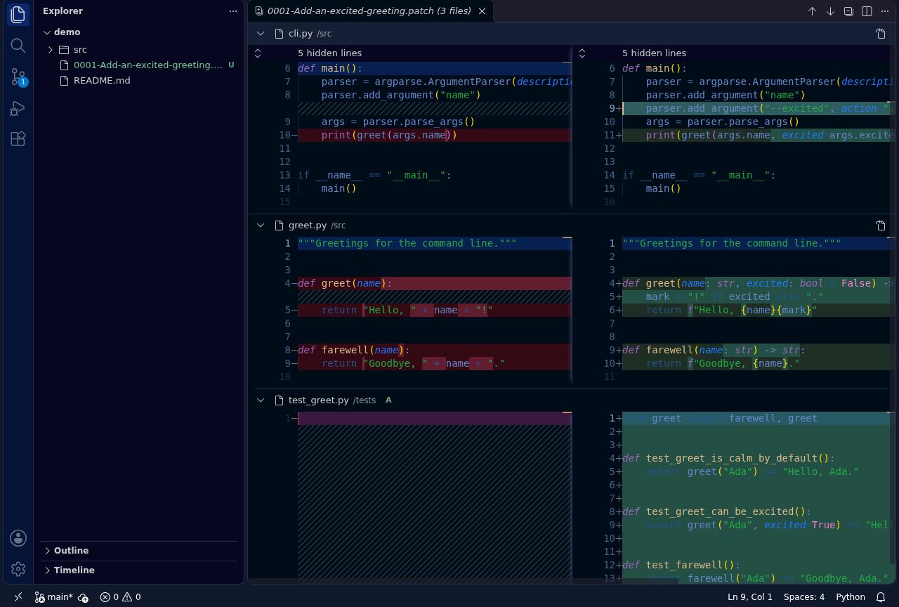

# View Patch

Review `.patch` and `.diff` files in one side-by-side **Changes** view in Visual Studio Code (VS Code).
Use complete files from a Git repository, or explicitly review just the patch hunks without any repository.

The **Patch Reviews** panel in the Explorer keeps the repository, base, file list, and review checklist alongside
the diff. The extension stays read-only and offline.

## Open a patch

- Right-click a patch in the Explorer and choose **Open Patch as Changes**.
- Choose **Open With...** > **View Patch (Changes)**. This is opt-in; installing the extension does not replace the
  normal text editor for patch files.
- With a patch open, use the **Open Patch as Changes** button in the editor title bar.
- Run **View Patch: Open Patch as Changes** from the Command Palette. Pasted, unsaved text also works when its editor
  language is Diff, and **Open Patch from Clipboard** skips even the paste.
- Drag patch files onto the **Patch Reviews** panel in the Explorer.
- Run **View Patch: Open Sample Patch** to try the viewer without any repository.
- Run **View Patch: Review a Commit...** to review any revision straight from history - no patch file at all.
  Merge commits show their changes versus each parent; a root commit is shown against the empty tree.

Selecting several files with the ordinary command opens independent reviews. To apply dependent patches in order,
use the series command below.

## Review complete files

A patch normally contains only edited lines and their surrounding context. For a complete-file review, View Patch
applies it in a private scratch area and reads each file before and after the change.

The extension searches:

1. repositories in the Source Control view;
1. workspace folders;
1. the patch file's folder;
1. extra folders in `viewPatch.repositories`.

When a `git format-patch` or `git show` file names a commit present in one of those repositories, the base is that
commit's parent. Otherwise, View Patch tries `HEAD` in the candidate repositories and asks when several apply.
The summary shows both the requested base and its frozen snapshot tree identifier.

An open workspace folder is not required: in an empty window, the patch file's folder and `viewPatch.repositories`
still locate the repository, and [hunk-only views](#review-hunks-without-a-repository) need none at all.

Use **Open Patch as Changes on a Repository and Base...**, or **Change Repository and Base...** on a review, to
choose a repository and revision yourself.

## Review hunks without a repository

Run **View Patch: View Patch Hunks Only**, or choose **View Hunks Only** when a complete-file review cannot apply.
This mode needs neither Git nor workspace trust.

The title, summary, and document headers explicitly say **partial context**. Only lines actually present in the
patch are shown, with original line ranges and omitted-context separators. Missing file contents are never invented.
Binary payloads are not reconstructed; only their supplied metadata is shown.

This is an explicit choice, not a silent fallback from a failed complete-file review.

## Review a patch series

- Open a mailbox containing several messages from `git format-patch --stdout` as an ordinary patch.
- Or select separate patch files and run **View Patch: Open Selected Patches as Series...**. The command also offers
  a multi-file picker. Numbered messages or filenames are sorted numerically; otherwise selection order is kept.
  Duplicate numbers are rejected rather than guessed.

Each patch is applied to the preceding patch's result in one private scratch area. **Patch Reviews** offers the
combined result and each individual patch, including subjects and authors. Cover letters are not applied as changes.
If the combined result has no net changes, the individual patches remain reviewable.

A hunk-only series shows individual messages, not a fabricated complete-file or cumulative reconstruction.

## Compare two patch versions

With a complete-file review open, **Compare with Another Patch...** applies the current patch and a second
file to the same frozen base, then opens the **result difference**: the first version's outcome on the left,
the second version's on the right. This is how a v2 of a change differs from its v1, not a textual diff of
the two patch files. Identical outcomes are reported without opening an empty review. A comparison cannot be
refreshed or rebased; run the command again.

## Merge commits

A combined merge diff (`git show` of a merge, `diff --cc`) is never applied as text. When the named commit
exists in a known repository, View Patch shows the merge's real changes **versus each parent**, read from
history. When the repository is not available, hunk-only mode shows explicit per-parent hunk views instead.

## Mailed patches

Message bodies encoded as `quoted-printable` or `base64` are decoded before parsing, so mailed patches with
encoded diffs review normally. Unsupported encodings and multipart mail are rejected with the reason named.

## Summary, checklist, and refresh

Expand **Patch Reviews** in the Explorer, or run **View Patch: Show Patch Reviews**.
Expand **Review Details** for the selected patch's subject, author, date, snapshot identifier, and detailed counts.
The panel divider can be dragged upward to give a large checklist more room.

- See the repository, base, subject, author, date, and added/modified/deleted/renamed file counts.
- Filter old and new paths with the filter button.
- Toggle each file's **reviewed** checkmark. Selecting a file opens its individual diff. **Mark All Reviewed**
  and **Clear Reviewed Checkmarks** work on the whole review, and the view's badge counts unreviewed files.
- **Next/Previous Unreviewed File** walk what is left; the `viewPatch.markReviewedOnOpen` setting checks files
  off as you open them.
- **Copy Review Summary as Markdown** copies the repository, base, file list, per-file line counts, and
  checkmarks for pasting into a report or chat. **Copy Diff for This File** puts one file's change on the
  clipboard as a valid unified diff.
- Inspect mode changes, submodule pointers, and renames without edits as explicit metadata entries rather than
  temporary notifications.
- Reopening the same source reuses its review instead of accumulating duplicate tabs.
- Use **Refresh Review** after editing the patch. Saving an open source patch also offers to refresh; it does not
  silently replace the snapshot you were reviewing.

Refresh keeps the selected repository and base expression. Checkmarks survive only for changes whose contents and
metadata are unchanged. Series navigation replaces the review's current Changes tab rather than opening a tab per
message. Regenerating the source patch outside the editor offers the same refresh as saving it in the editor;
the open snapshot is never silently replaced.

Reviews are also remembered across reloads: reopening an unchanged patch restores its reviewed checkmarks and
retries the previously chosen repository and base first, and **Reopen Recent Patch...** lists recent reviews,
including series. The remembered list stays on this machine.

## Read-only, bounded operation

Your repository's working tree, index, references, and objects are not modified. Git uses a private index and object
database, and object-writing commands cannot access the source alternates. Scratch data is removed on success,
failure, cancellation, and limits. Missing objects are not fetched from a remote.

Both sides are then served as read-only, in-memory documents. There is no arbitrary twenty-review eviction:
content remains available while its Changes tab or individual file diff is open. Closing the last owned tab releases
the extension's buffers.

Binary and undecodable files show their sizes and content fingerprints, so equal-size binary changes cannot look
identical merely because their lengths match. Text with recognized byte-order marks is decoded explicitly.

Loading progress has a **Cancel** button. Default limits use mebibytes (MiB), where one MiB is 1,048,576 bytes:

| Limit                           | Default                 | Setting                       |
| ------------------------------- | ----------------------- | ----------------------------- |
| Input patch or assembled series | 10 MiB                  | `viewPatch.maxPatchSizeMiB`   |
| Unique loaded file content      | 64 MiB per review       | `viewPatch.maxContentSizeMiB` |
| Retained open file buffers      | 128 MiB                 | `viewPatch.maxOpenContentMiB` |
| Each Git command                | 30 seconds              | `viewPatch.gitTimeoutSeconds` |
| Combined Git output             | 64 MiB per command      | fixed                         |

Limits fail explicitly; they do not truncate content or evict another open review. Close reviews or adjust the
appropriate setting before retrying. The retained-content limit counts file buffers, not VS Code's own text models
or all JavaScript object overhead. The output limit includes both standard output and standard error.

Set these options in user or remote settings, not workspace settings. `viewPatch.repositories` defaults to `[]`;
a leading `~` in an extra repository path means your home folder.

## Requirements and limits

- VS Code 1.90 or newer.
- Git on `PATH`, or configured through `git.path`, for complete-file reviews.
- Workspace trust for Git-backed reviews. Hunk-only views work in Restricted Mode.
- In a remote window, the extension and Git-backed operations run next to the remote repositories.
- In VS Code for the Web and virtual workspaces, hunk-only reviews work; Git-backed reviews need a desktop
  window with a local repository. Web support is new and still being exercised.
- Git and standard unified diffs are supported, including combined merge diffs as described above.
  Malformed or truncated hunks are rejected explicitly. `quoted-printable` and `base64` mail bodies are
  decoded; other encodings and multipart mail are rejected with the reason named.

## Privacy and troubleshooting

View Patch does not collect telemetry, contact a hosting service, or fetch missing objects. The **View Patch** output
channel (**View** > **Output**) explains repository selection, cancellation, limits, and Git failures.
For a bug report, **View Patch: Copy Diagnostics** puts the version, editor, platform, and Git details on the
clipboard, and **Open Sample Patch** checks an install without touching any repository.

### Common first-run errors

| Message | Meaning | Fix |
| ------- | ------- | --- |
| `The patch does not apply in the available repositories` with `<file>: does not exist in the index` | The base commit does not contain that file - the base is a frozen commit snapshot, so an uncommitted working-tree file does not count | Commit the file first (or pick the right repository and base with **Open Patch as Changes on a Repository and Base...**), or use **View Hunks Only** |
| `Truncated hunk: ... a context line that lost its leading space is the usual cause` | A hand-typed or copy-pasted hunk body line is missing its leading space, `-`, or `+` | Generate patches with `git diff > file.patch` or `git format-patch` instead of typing them; verify with `git apply --check file.patch` |
| `Unexpected patch content: ... counts are smaller than its body` | The `@@ -start,count +start,count @@` header promises fewer lines than the hunk contains | Same fix: generate, do not hand-edit; editors that trim whitespace on save also corrupt patches |

## License

[MIT](LICENSE)
